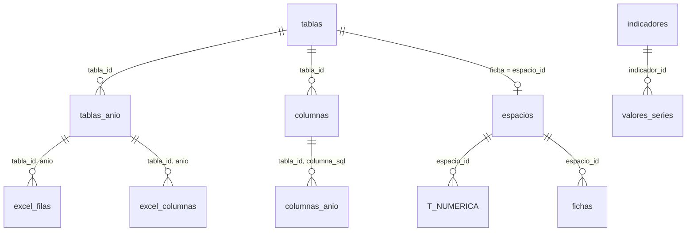

# Base de datos relacional `universidatos.sqlite`

Contiene todas las tablas anuales (2018–2025) y las series históricas (2004–2025) de la Agenda Estadística de la UAEMEX, con las mismas cifras que `tablas_uaemex.json` y `series_uaemex.json`: las 892,647 celdas y los 8,427 valores de series se compararon uno por uno con esos archivos sin diferencias. Se reconstruye con `python scripts/construir_sqlite.py`.

## Tablas

### Catálogo

| Tabla | Contenido |
|---|---|
| `tablas` | Una fila por tabla de la Agenda: `tabla_id` (A26), `tabla_sql` (t_a26), `seccion`, `tipo` (numerica, lista, ficha), `titulo`, `anios` |
| `tablas_anio` | Título, archivo Excel, fuente y notas de cada tabla en cada año |
| `columnas` | Columnas de cada tabla: `columna_sql`, `etiqueta` original (con › entre niveles), `sumable` (0 para promedios, índices o porcentajes) |
| `columnas_anio` | Encabezados que cambian de un año a otro (p. ej. «Matrícula 2024-2025») |
| `espacios` | Los 63 espacios académicos con ficha: `espacio_id` (O15, U08, B01…), `espacio` (nombre corto), `nombre` completo y `tipo_espacio` |

### Datos

| Tabla | Contenido |
|---|---|
| `t_<id>` numéricas (232) | Formato ancho, una fila por renglón de la tabla y año. Columnas fijas: `anio`, `fila_id`, `ruta` (jerarquía completa del renglón), `nivel1`…`nivel5`, `profundidad`, `es_subtotal` (1 si el renglón tiene renglones hijos), `bloque` (nivel educativo u otro agrupador antes del espacio), `tipo_espacio`, `espacio_id`, `espacio`, `detalle` (programa u otro desglose dentro del espacio; NULL en el renglón del espacio). Después, una columna REAL por cada columna de datos |
| `t_<id>` listas (132) | Listas de texto: `anio`, `renglon` y una columna TEXT por encabezado |
| `fichas` | Las 63 fichas por espacio en formato largo: `tabla_id`, `espacio`, `anio`, `seccion`, `concepto`, `valor` |
| `indicadores` | Las 508 series históricas: `indicador_id` (His01-46), `eje`, `concepto`, `ruta` |
| `valores_series` | Valor de cada indicador por año |

### Trazabilidad

| Tabla | Contenido |
|---|---|
| `excel_filas` | Renglón del Excel original de cada `fila_id` (o `renglon`) por tabla y año |
| `excel_columnas` | Columna (letra) del Excel original de cada `columna_sql` por tabla y año |

## Llaves primarias y foráneas

Todas las tablas tienen llave primaria y las relaciones están declaradas como llaves foráneas; `PRAGMA foreign_key_check` no reporta ninguna violación. SQLite solo las hace cumplir al escribir si la conexión activa `PRAGMA foreign_keys = ON`.

| Tabla | Llave primaria | Llaves foráneas |
|---|---|---|
| `tablas` | `tabla_id` | — |
| `tablas_anio` | `(tabla_id, anio)` | `tabla_id` → `tablas` |
| `columnas` | `(tabla_id, columna_sql)` | `tabla_id` → `tablas` |
| `columnas_anio` | `(tabla_id, columna_sql, anio)` | `(tabla_id, columna_sql)` → `columnas`; `(tabla_id, anio)` → `tablas_anio` |
| `espacios` | `espacio_id` | `espacio_id` → `tablas` (su ficha) |
| `t_<id>` numéricas | `(anio, fila_id)` | `espacio_id` → `espacios` |
| `t_<id>` listas | `(anio, renglon)` | — |
| `fichas` | `(tabla_id, anio, renglon)` | `espacio_id` → `espacios`; `(tabla_id, anio)` → `tablas_anio` |
| `indicadores` | `indicador_id` | — |
| `valores_series` | `(indicador_id, anio)` | `indicador_id` → `indicadores` |
| `excel_filas` | `(tabla_id, anio, fila_id)` | `(tabla_id, anio)` → `tablas_anio` |
| `excel_columnas` | `(tabla_id, anio, columna_sql)` | `(tabla_id, anio)` → `tablas_anio`; `(tabla_id, columna_sql)` → `columnas` |

Dos relaciones no pueden declararse como llave foránea porque apuntan a una tabla distinta según el valor de `tabla_id`: `excel_filas.fila_id` corresponde a `t_<tabla_id>(anio, fila_id)` y `tablas.tabla_sql` es el nombre de la tabla de datos. Se resuelven uniendo por `tabla_id`, como en el último ejemplo.



Las tablas de datos (`t_a26`, `t_p03`…) se relacionan entre sí por `espacio_id` y `anio`, por ejemplo para calcular alumnos por profesor de tiempo completo:

```sql
SELECT e.nombre, m.total * 1.0 / (p.profesoras_es_tiempo_completo_hombres + p.profesoras_es_tiempo_completo_mujeres) AS alumnos_por_ptc
FROM t_a26 m
JOIN t_p03 p ON p.espacio_id = m.espacio_id AND p.anio = m.anio AND p.detalle IS NULL
JOIN espacios e ON e.espacio_id = m.espacio_id
WHERE m.anio = 2025 AND m.detalle IS NULL AND e.tipo_espacio = 'Facultad'
ORDER BY alumnos_por_ptc;
```

## Convenciones

- El renglón de un espacio tiene `espacio_id` y `detalle IS NULL`; sus programas tienen el mismo `espacio_id` y el nombre del programa en `detalle`.
- `espacio_id` es estable entre años aunque cambie la etiqueta del grupo: Tianguistenco (`U08`) aparece como unidad académica profesional hasta 2024 y como centro universitario en 2025; `tipo_espacio` conserva la etiqueta de cada año.
- Las celdas vacías del Excel original son NULL.
- La matrícula total de la UAEMEX es la del sistema dependiente; el sistema incorporado va en columnas aparte (tabla A12) o en el eje «Sistema incorporado» de las series.

## Ejemplos

```sql
-- Alumnos de licenciatura de la Facultad de Ingeniería en 2025
SELECT total FROM t_a26 WHERE anio = 2025 AND espacio_id = 'O15' AND detalle IS NULL;

-- Matrícula por programa de Tianguistenco
SELECT detalle, total_hombres, total_mujeres, total FROM t_a26
WHERE anio = 2025 AND espacio_id = 'U08' AND detalle IS NOT NULL ORDER BY total DESC;

-- Profesores de tiempo completo por facultad
SELECT espacio, profesoras_es_tiempo_completo_hombres + profesoras_es_tiempo_completo_mujeres AS ptc
FROM t_p03 WHERE anio = 2025 AND tipo_espacio = 'Facultad' AND detalle IS NULL ORDER BY ptc DESC;

-- Celda de Excel de donde sale un dato
SELECT f.fila_excel, c.columna_excel, a.archivo
FROM excel_filas f JOIN excel_columnas c ON c.tabla_id = f.tabla_id AND c.anio = f.anio
JOIN tablas_anio a ON a.tabla_id = f.tabla_id AND a.anio = f.anio
WHERE f.tabla_id = 'A26' AND f.anio = 2025 AND f.fila_id = (SELECT fila_id FROM t_a26 WHERE anio = 2025 AND espacio_id = 'O15' AND detalle IS NULL)
  AND c.columna_sql = 'total';

-- Buscar tablas por tema
SELECT tabla_id, tabla_sql, titulo FROM tablas WHERE titulo LIKE '%becas%';
```

`local_server/sql_referencia.json` tiene la consulta de referencia de cada una de las 46 preguntas con respuesta del experimento; las 46 reproducen la respuesta correcta.
